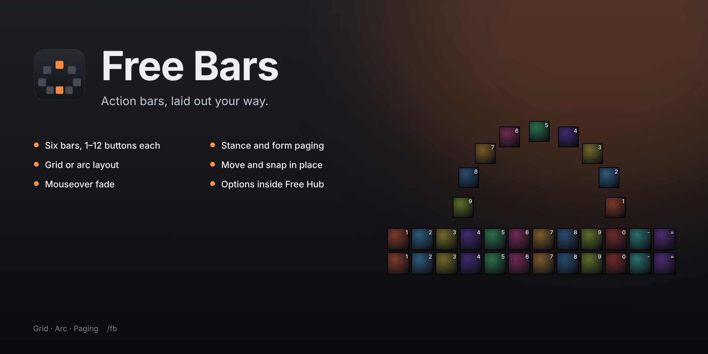
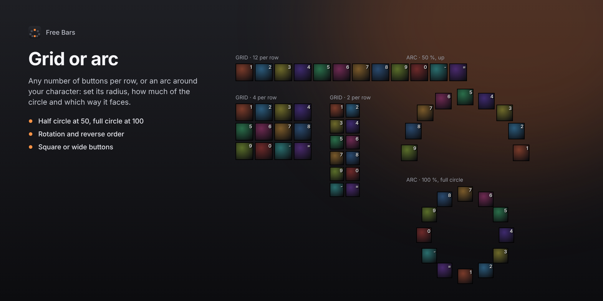
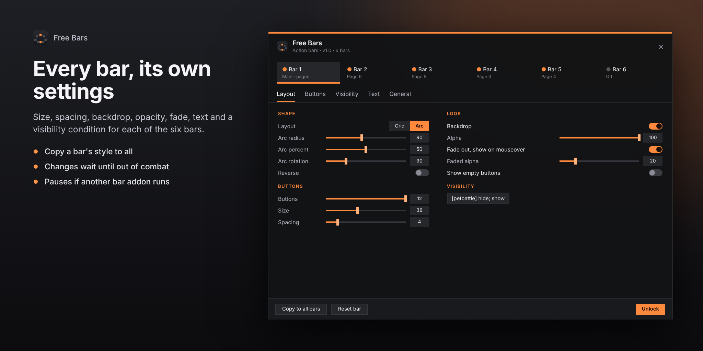
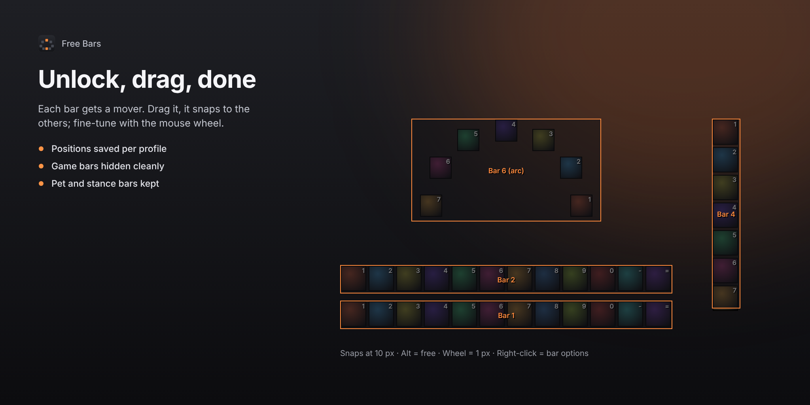

<h1 align="center">Free Bars</h1>

Up to 9 action bars, laid out as a grid or an arc, with mouseover fade, paging and a clean flat look.

<a href="https://www.curseforge.com/wow/addons/freebars"><b>Download on CurseForge</b></a> · version <b>1.4.2</b> · WoW Forever (1.60.1) · <code>/fb</code>

## Screenshots

<table>
<tr>
<td width="50%" valign="top"> <b>Grid or arc</b> Any number of buttons per row, or an arc around your character.</td>
<td width="50%" valign="top"> <b>Every bar, its own settings</b> Size, spacing, backdrop, opacity, fade, text and visibility per bar.</td>
</tr>
<tr>
<td width="50%" valign="top"> <b>Unlock, drag, done</b> Movers with a grid and snapping.</td>
</tr>
</table>

Action bars for WoW Forever, laid out exactly the way you want: up to **9 bars**, each as a grid or as an **arc** around your character.

## Features

- **9 bars**, 1 to 12 buttons each. Bars 1 to 6 use the game's usual action pages and key bindings; bars 7 to 9 use the extra action bars 5, 6 and 7.
- **Grid or arc**: buttons per row, or an arc with its radius, how much of the circle (50 = half circle, 100 = full circle), rotation and reverse order.
- **Per bar**: button size and height, spacing, scale, backdrop, opacity, fade out with show on mouseover, show empty buttons, **empty button colour**, key binding / macro / count texts, and a visibility condition (macro syntax, e.g. `[petbattle] hide; show`).
- **Paging** of bar 1 for forms, stances, stealth, vehicle and possession (automatic per class, or your own condition).
- **Flat or Blizzard style**, short key binding texts (`S1`, `C2`, `M4`…), range colouring, cast on key down.
- **Fonts** with a live preview in the list, and outline choice.
- The game's own bars are hidden safely (no taint): pet and stance bars, micro menu and bags stay where they are.
- **Unlock mode**: drag each bar, snap to other bars or to a grid, show the grid, fine-tune with the mouse wheel.
- **Profiles**: every character gets its own profile automatically; copy another character's, export / import.

**Want more fonts?** Install [SharedMedia Additional Fonts](https://www.curseforge.com/wow/addons/shared-media-additional-fonts) (or any LibSharedMedia font pack): its fonts appear automatically in the font lists.

## Commands

- `/fb` — options
- `/fb unlock` — move the bars

## Free Hub

Free Bars works on its own. With **Free Hub** installed, its options open inside the hub next to the other Free addons, and a single minimap button replaces theirs.

## Notes

- Built for WoW Forever. Changes made in combat are applied when combat ends.
- Pauses itself with a message if Bartender4, Dominos or ElvUI's action bars are active.
- Embeds LibActionButton-1.0 (BSD licence, by Nevcairiel; licence included), renamed LibActionButton-1.0-Free.
- Bug reports and ideas are welcome in the comments.

## The Free suite

Addons for WoW Forever that share the same look, profiles and a single minimap button through Free Hub.

| | Addon | |
|---|---|---|
|  | **[Free Hub](https://github.com/DecardCainSuite/FreeHub)** — All the Free addons in one window: options side by side, product pages with gallery, and a single minimap button. | [CurseForge](https://www.curseforge.com/wow/addons/free-hub) |
|  | **[Free Unit Frames](https://github.com/DecardCainSuite/FreeUnitFrames)** — Fully customisable unit frames for player, target, focus, party, raid and bosses, with an ElvUI-style preset in one click. | [CurseForge](https://www.curseforge.com/wow/addons/freeunitframes) |
|  | **[Free Bars](https://github.com/DecardCainSuite/FreeBars)** (this one) — Up to 9 action bars, laid out as a grid or an arc, with mouseover fade, paging and a clean flat look. | [CurseForge](https://www.curseforge.com/wow/addons/freebars) |
|  | **[Free Swing](https://github.com/DecardCainSuite/FreeSwing)** — Swing timers for main hand, off hand and ranged, at exactly the size and style you want. | [CurseForge](https://www.curseforge.com/wow/addons/freeswing) |
|  | **[Free Minimap](https://github.com/DecardCainSuite/FreeMinimap)** — A rectangular minimap of any size, with a region map drawn from the game's own terrain tiles around you. | [CurseForge](https://www.curseforge.com/wow/addons/freeminimap) |
|  | **[Free Guild](https://github.com/DecardCainSuite/FreeGuild)** — Guild roster and rank tool for guild masters and officers: filters, bulk ranks, rules that promote for you, guild info and notes. | [CurseForge](https://www.curseforge.com/wow/addons/freeguild) |
|  | **[Free LFG](https://github.com/DecardCainSuite/FreeLFG)** — The group finder as a compact, sortable table: leader, roles, free slots, one-click whisper from a template, and live filters you write yourself. | [CurseForge](https://www.curseforge.com/wow/addons/freelfg) |

## Changelog

What is new in the current version: [CHANGELOG.md](CHANGELOG.md). Full history: [CHANGELOG-history.md](CHANGELOG-history.md).

## Repository layout and releases

- The repository root is the addon folder (`FreeBars/`), as installed in `Interface\AddOns`.
- `curseforge/` holds the CurseForge page: `description.md` (fields, gallery captions, description) and `images/` (logo, gallery, social preview). It is not shipped in the addon zip.
- `CHANGELOG.md` holds the notes of the version being prepared; they are sent to CurseForge as the file's changelog.
- Releasing: bump `## Version` in `FreeBars.toc`, write `CHANGELOG.md`, then publish a GitHub release named `v<version>`. GitHub Actions packages the addon with the [BigWigs packager](https://github.com/BigWigsMods/packager) and uploads it to CurseForge and to the GitHub release.

Bug reports and ideas are welcome in the issues or in the CurseForge comments.
